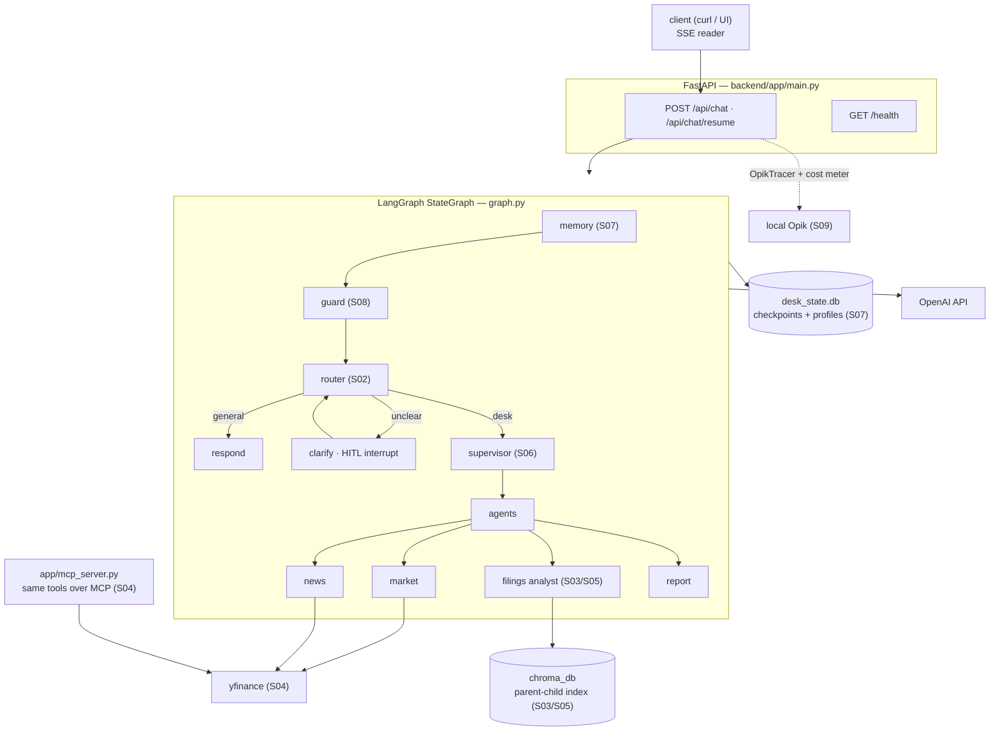

# AlphaDesk Sessions 09–10 Implementation Plan

> **For agentic workers:** REQUIRED SUB-SKILL: Use superpowers:subagent-driven-development (recommended) or superpowers:executing-plans to implement this plan task-by-task. Steps use checkbox (`- [ ]`) syntax for tracking.

**Goal:** Finish the AlphaDesk curriculum: Session 09 (Opik tracing + per-run `cost` SSE event + eval experiments) and Session 10 (Docker packaging, `/health`, architecture diagram).

**Architecture:** Session 09 adds one new module (`app/observability.py`) and threads a `UsageMetadataCallbackHandler` + env-gated `OpikTracer` through `stream_graph()`'s run config; `eval_retrieval.py` gains additive Opik experiment logging. Session 10 makes the two state paths env-overridable, adds `GET /health`, and packages the backend with a Dockerfile + root compose file whose named volume holds all state.

**Tech Stack:** FastAPI, LangGraph 1.2.7, langchain-core 1.4.8 (`UsageMetadataCallbackHandler`), langchain-openai 1.3.3 (`stream_usage`), Opik SDK (local server), Docker + compose.

## Global Constraints

- **One commit + one tag per session** (`session-09`, `session-10`) — individual tasks do NOT commit; each session's final task commits everything for that session. This repo convention overrides per-task commits.
- **OpenAI stack only** — never introduce `anthropic`/`langchain-anthropic`.
- **No pushes to any remote.** Never commit `docs/INSTRUCTOR_PLAYBOOK.md` (gitignored).
- **Verification runs on port 8010** — port 8000 belongs to another project; **never kill listeners you didn't start** (that includes the node process on 5173).
- **No test framework** — this repo verifies by runnable demo (repo convention). Every task ends with exact verification commands instead of pytest.
- Working dir for backend commands: `/Users/nisargkadam/Documents/Personal Projects/FinalProject/backend`; the venv is uv-managed (`uv pip install …` from `backend/`; there is **no** `.venv/bin/pip`).
- Per-session changed-application-line budget is ~250 (see the "Budget note" convention in `docs/sessions/SESSION_08_NOTES.md`).
- The user's `~/.opik.config` exists (`url_override = http://localhost:5173/api/`, `workspace = default`). The local Opik **server may be down** (currently a Vite dev server holds 5173, Docker daemon stopped). All Opik code must be failure-safe; verification has a documented fallback when the server is unreachable.

---

## Session 09 — Observability & LLMOps

### Task 1: `app/observability.py` + dependency + env flags

**Files:**
- Create: `backend/app/observability.py`
- Modify: `backend/requirements.txt` (append Session 09 block)
- Modify: `backend/.env.example` (append Opik flags)

**Interfaces:**
- Consumes: nothing from other tasks.
- Produces: `make_tracer() -> OpikTracer | None` and `cost_payload(usage_by_model: dict) -> dict` — Task 2 imports both. `PRICES_PER_MTOK: dict[str, tuple[float, float]]`.

- [ ] **Step 1: Install and pin opik**

```bash
cd "/Users/nisargkadam/Documents/Personal Projects/FinalProject/backend"
uv pip install opik
.venv/bin/python -c "import importlib.metadata as m; print(m.version('opik'))"
```

Expected: prints a version (e.g. `1.9.x`). Append to `backend/requirements.txt`, pinning the printed version:

```
# Session 09 — Observability & LLMOps
opik==<printed version>
```

- [ ] **Step 2: Append to `backend/.env.example`**

```
# Session 09: ship traces + eval experiments to a locally hosted Opik
# (https://github.com/comet-ml/opik). The SDK reads ~/.opik.config for the
# server URL; with tracing off, nothing changes.
OPIK_TRACING=false
OPIK_PROJECT_NAME=alphadesk
```

Also add `OPIK_TRACING=false` and `OPIK_PROJECT_NAME=alphadesk` to `backend/.env` (do not touch the existing keys).

- [ ] **Step 3: Create `backend/app/observability.py`**

```python
"""Session 09: observability — the pipeline grows a price tag and a tracer.

Two concerns, deliberately separate from the graph:

- COST: every LangChain model response carries `usage_metadata`; a
  UsageMetadataCallbackHandler (created per run in main.py) aggregates it
  per model, and this module prices the totals so every stream can end
  with one `cost` event. Hand-rolled on purpose — the arithmetic is the
  lesson.
- TRACES: OpikTracer ships the same run to a locally hosted Opik instance
  as a full trace tree. Env-gated and failure-wrapped: observability that
  can take down the desk is worse than no observability at all.
  (LangSmith and Langfuse are the managed equivalents of this file.)
"""

import os

# USD per 1M tokens (input, output) — OpenAI list prices. A model missing
# from this table still streams its token counts; the usd field goes null
# rather than guessing.
PRICES_PER_MTOK: dict[str, tuple[float, float]] = {
    "gpt-4.1-mini": (0.40, 1.60),
    "gpt-4.1-nano": (0.10, 0.40),
    "gpt-4o-mini": (0.15, 0.60),
}


def make_tracer():
    """The env-gated, failure-wrapped Opik tracer — or None.

    The import lives inside the function: a missing or broken opik install
    must not break main.py at import time, and OPIK_TRACING=false must not
    pay opik's import cost at all.
    """
    if os.getenv("OPIK_TRACING", "false").lower() != "true":
        return None
    try:
        from opik.integrations.langchain import OpikTracer

        return OpikTracer(project_name=os.getenv("OPIK_PROJECT_NAME", "alphadesk"))
    except Exception:
        return None  # tracing is optional; the desk is not


def cost_payload(usage_by_model: dict) -> dict:
    """Fold a run's per-model usage into the `cost` event payload.

    Input shape (UsageMetadataCallbackHandler.usage_metadata):
        {"gpt-4.1-mini": {"input_tokens": 2841, "output_tokens": 412, ...}}
    """
    input_tokens = sum(u.get("input_tokens", 0) for u in usage_by_model.values())
    output_tokens = sum(u.get("output_tokens", 0) for u in usage_by_model.values())
    usd, priced = 0.0, True
    for model, usage in usage_by_model.items():
        prices = PRICES_PER_MTOK.get(model)
        if prices is None:
            priced = False
            continue
        usd += usage.get("input_tokens", 0) / 1e6 * prices[0]
        usd += usage.get("output_tokens", 0) / 1e6 * prices[1]
    return {
        "input_tokens": input_tokens,
        "output_tokens": output_tokens,
        "usd": round(usd, 6) if priced else None,
        "by_model": {
            model: {
                "input_tokens": usage.get("input_tokens", 0),
                "output_tokens": usage.get("output_tokens", 0),
            }
            for model, usage in usage_by_model.items()
        },
    }
```

- [ ] **Step 4: Verify the module standalone**

```bash
cd "/Users/nisargkadam/Documents/Personal Projects/FinalProject/backend"
.venv/bin/python -c "
from app.observability import cost_payload, make_tracer
p = cost_payload({'gpt-4.1-mini': {'input_tokens': 1_000_000, 'output_tokens': 500_000}})
assert p['usd'] == 1.2, p          # 0.40 + 0.5*1.60
assert p['input_tokens'] == 1_000_000
p2 = cost_payload({'gpt-9-unknown': {'input_tokens': 10, 'output_tokens': 10}})
assert p2['usd'] is None, p2       # unpriced model -> null, tokens intact
import os; os.environ['OPIK_TRACING'] = 'false'
assert make_tracer() is None
os.environ['OPIK_TRACING'] = 'true'
print('tracer:', type(make_tracer()).__name__)
print('OK')
"
```

Expected: `tracer: OpikTracer` (or `NoneType` if opik errors — also acceptable, that's the failure-safe path) and `OK`.

---

### Task 2: Wire cost + tracer into the stream

**Files:**
- Modify: `backend/app/main.py` (docstring line ~6, `stream_graph` at lines 66–93)
- Modify: `backend/app/graph.py:117-122` (the two `ChatOpenAI` constructions)

**Interfaces:**
- Consumes: `make_tracer`, `cost_payload` from Task 1; `UsageMetadataCallbackHandler` from `langchain_core.callbacks`.
- Produces: the `cost` SSE event: `{"type":"cost","input_tokens":int,"output_tokens":int,"usd":float|null,"by_model":{model:{input_tokens,output_tokens}}}`, emitted once per completed run immediately before `done`.

- [ ] **Step 1: `graph.py` — usage on streamed calls**

Replace lines 117–122 with:

```python
# Session 09: streamed calls only report token usage when asked —
# without stream_usage the cost meter reads zero for every node that
# streams (which, under astream's messages mode, is all of them).
llm = ChatOpenAI(model=os.environ["OPENAI_MODEL"], stream_usage=True)

# Classification and planning want determinism, not creativity: the router
# and supervisor run at temperature 0 so the same question takes the same
# path in every class.
router_llm = ChatOpenAI(model=os.environ["OPENAI_MODEL"], temperature=0, stream_usage=True)
```

- [ ] **Step 2: `main.py` — imports and vocabulary docstring**

In the module docstring, extend the vocabulary line `· S08: + guardrail` to `· S08: + guardrail · S09: + cost`. Below the existing imports add:

```python
from langchain_core.callbacks import UsageMetadataCallbackHandler  # noqa: E402

from .graph import compile_graph  # noqa: E402  (imported after the env is loaded)
from .observability import cost_payload, make_tracer  # noqa: E402
from .sse import event  # noqa: E402
```

(i.e. one new import line; keep the two existing `from .…` lines as they are.)

- [ ] **Step 3: `main.py` — meter + tracer in `stream_graph`**

Replace the body of `stream_graph` so it reads:

```python
async def stream_graph(graph_input, thread_id: str):
    # thread_id selects which checkpointed conversation this run extends —
    # state lives server-side in the checkpointer, not in the request.
    # Session 09: each run carries its own token meter, and (when
    # OPIK_TRACING is on) a tracer shipping the run to local Opik. Both are
    # callbacks — the graph itself doesn't know it's being observed.
    usage = UsageMetadataCallbackHandler()
    callbacks: list = [usage]
    tracer = make_tracer()
    if tracer is not None:
        callbacks.append(tracer)
    config = {"configurable": {"thread_id": thread_id}, "callbacks": callbacks}
    try:
        # LangGraph's current streaming API: astream with multiple modes.
        #   "messages" → per-token chunks from LLM calls inside nodes
        #   "custom"   → whatever nodes write via get_stream_writer()
        #   "updates"  → node results; also where an interrupt surfaces
        async for mode, chunk in graph.astream(
            graph_input, config, stream_mode=["messages", "custom", "updates"]
        ):
            if mode == "custom":
                yield event(**chunk)
            elif mode == "messages":
                token, meta = chunk
                # Only answer-writing nodes stream to the user; the router,
                # supervisor, and sub-agents also produce tokens here and
                # must not leak. (First main.py change since Session 02 —
                # Session 06 added `report` as a second answering node.)
                if token.content and meta.get("langgraph_node") in ("respond", "report"):
                    yield event("token", text=token.content)
            elif mode == "updates" and "__interrupt__" in chunk:
                yield event("interrupt", question=chunk["__interrupt__"][0].value["question"])
        # The price tag: one cost event per run, just before done. Absent
        # only when the run made no model calls at all.
        if usage.usage_metadata:
            yield event("cost", **cost_payload(usage.usage_metadata))
        yield event("done")
    except Exception as exc:
        # A failure mid-stream must be an event, not a dead socket.
        yield event("error", message=str(exc))
```

- [ ] **Step 4: Verify on port 8010**

```bash
cd "/Users/nisargkadam/Documents/Personal Projects/FinalProject/backend"
.venv/bin/uvicorn app.main:app --port 8010 &   # remember the PID
sleep 3
curl -sN localhost:8010/api/chat -H 'Content-Type: application/json' \
  -d '{"message":"What is a P/E ratio?","thread_id":"obs-verify-1"}' | tail -5
```

Expected: a `{"type":"cost","input_tokens":…,"output_tokens":…,"usd":…,"by_model":{…}}` line between the last `token` and `done`, with non-zero token counts and non-null `usd` (the configured model is in the price table). Then a desk run:

```bash
curl -sN localhost:8010/api/chat -H 'Content-Type: application/json' \
  -d '{"message":"Brief me on Apple — price action and latest news.","thread_id":"obs-verify-2"}' \
  | grep -o '"type":"[a-z_]*"' | sort | uniq -c
```

Expected: event types include `cost` exactly once. Kill **only** the uvicorn you started (`kill <PID>`).

- [ ] **Step 5: Verify Opik path (both branches)**

With `OPIK_TRACING=true` in `backend/.env`, restart uvicorn on 8010 and re-run the first curl. Two acceptable outcomes:
  - **Opik server reachable:** open the local Opik UI, project `alphadesk` — the run appears as a trace tree (memory → guard → router → respond). Screenshot-worthy; note it in the session notes demo.
  - **Opik server down (current machine state):** the stream must behave identically (all events incl. `cost`, no `error` event, no crash) — failure-safety is itself the verification. Note in the final report that the live-trace demo needs the user's Opik server started.

Reset `OPIK_TRACING=false` in `backend/.env` afterwards; kill the uvicorn you started.

---

### Task 3: Eval runs → Opik experiments

**Files:**
- Modify: `backend/app/eval_retrieval.py` (imports at top; new `log_to_opik`; two lines in `main()`)

**Interfaces:**
- Consumes: existing `rank_of_expected`, `CONFIGS`, `K`; Opik SDK (`opik.Opik().get_or_create_dataset`, `opik.evaluation.evaluate`, custom `BaseMetric`).
- Produces: Opik dataset `alphadesk-golden`; one experiment per retrieval config named `retrieval: <config>` scoring `hit@1`, `hit@4`, `reciprocal_rank`. CLI output unchanged when Opik is off.

- [ ] **Step 1: Add imports and dotenv**

At the top of `eval_retrieval.py`, extend the import block:

```python
import json
import os
import sys
from pathlib import Path

from dotenv import load_dotenv

from .tools import rerank_filings, search_filings

load_dotenv()  # Session 09: the CLI honors backend/.env (OPIK_* flags)
```

- [ ] **Step 2: Add `log_to_opik` (after `CONFIGS`, before `main`)**

```python
def log_to_opik(golden: list[dict]) -> None:
    """Session 09: the same numbers, but with a history. Each run becomes an
    Opik experiment over a dataset built from the golden questions — tune
    chunking next month and the dashboard shows whether MRR actually moved.

    Additive and failure-safe by design: OPIK_TRACING=false, a missing SDK,
    or an unreachable server all leave the Session 05 CLI output untouched.
    """
    if os.getenv("OPIK_TRACING", "false").lower() != "true":
        return
    try:
        import opik
        from opik.evaluation import evaluate
        from opik.evaluation.metrics import base_metric, score_result

        class RankScore(base_metric.BaseMetric):
            """Scores one retrieval from the rank the task computed."""

            def __init__(self, name: str, fn):
                super().__init__(name)
                self._fn = fn

            def score(self, rank=None, **_):
                return score_result.ScoreResult(name=self.name, value=self._fn(rank))

        metrics = [
            RankScore("hit@1", lambda r: float(r == 1)),
            RankScore(f"hit@{K}", lambda r: float(bool(r and r <= K))),
            RankScore("reciprocal_rank", lambda r: 1 / r if r else 0.0),
        ]
        dataset = opik.Opik().get_or_create_dataset(name="alphadesk-golden")
        dataset.insert(golden)  # Opik dedupes identical rows — re-runs are safe
        for name, retrieve in CONFIGS.items():
            evaluate(
                experiment_name=f"retrieval: {name}",
                dataset=dataset,
                task=lambda item, r=retrieve: {"rank": rank_of_expected(r(item["question"]), item)},
                scoring_metrics=metrics,
                project_name=os.getenv("OPIK_PROJECT_NAME", "alphadesk"),
            )
        print("\nLogged to Opik: dataset 'alphadesk-golden', one experiment per configuration.")
    except Exception as exc:  # observability must never fail the eval itself
        print(f"\n(Opik logging skipped: {exc})")
```

Implementation note: `evaluate()` calls each metric's `score(**kwargs)` with the dataset-item fields merged with the task's output dict, so `rank` arrives as a keyword. If a runtime signature mismatch appears, pass `scoring_key_mapping={"rank": "rank"}` to `evaluate` — do not restructure.

- [ ] **Step 3: Call it from `main()`**

After the `for name, retrieve in CONFIGS.items():` loop's final `print`, insert:

```python
    log_to_opik(golden)
```

(before the existing `print("\nRe-run with RERANK_ENABLED=false…")` line).

- [ ] **Step 4: Verify both branches**

```bash
cd "/Users/nisargkadam/Documents/Personal Projects/FinalProject/backend"
.venv/bin/python -m app.eval_retrieval
```

Expected (OPIK_TRACING=false): output byte-identical to Session 05 (the table, no Opik lines). Then set `OPIK_TRACING=true` in `backend/.env` and re-run:
  - **Server reachable:** `Logged to Opik: …` line; dataset + three experiments visible in the Opik UI.
  - **Server down:** `(Opik logging skipped: …)` line, table intact, exit code 0.

Reset `OPIK_TRACING=false` in `backend/.env`.

---

### Task 4: Session 09 docs + commit + tag

**Files:**
- Modify: `README.md` (event table, new Observability section, session map)
- Create: `docs/sessions/SESSION_09_NOTES.md`
- Commit: everything from Tasks 1–4; tag `session-09`.

**Interfaces:**
- Consumes: the `cost` event shape from Task 2 (payload keys exactly: `input_tokens`, `output_tokens`, `usd`, `by_model`).
- Produces: the committed, tagged Session 09.

- [ ] **Step 1: README event table row** (after the `guardrail` row):

```markdown
| `cost`      | S09   | `input_tokens`, `output_tokens`, `usd`, `by_model` | The run's price tag, just before `done`. `usd` is null if a model is missing from the price table. |
```

- [ ] **Step 2: README Observability section** (after "Retrieval evaluation (Session 05)"):

```markdown
## Observability (Session 09)

Cost needs no server at all: every `/api/chat` stream now ends with a `cost`
event — the run's token totals and a USD estimate — just before `done`.

Set `OPIK_TRACING=true` in `backend/.env` to also ship every run as a full
trace tree (router → supervisor → specialists → report, with prompts,
latencies, and token counts) to a locally hosted
[Opik](https://github.com/comet-ml/opik) instance — the SDK reads
`~/.opik.config` for the server URL. Tracing off or server down: nothing
changes; observability is strictly additive.

With Opik on, `python -m app.eval_retrieval` also logs each run as an
experiment over the `alphadesk-golden` dataset — retrieval changes get a
tracked history instead of terminal numbers that scroll away.
```

- [ ] **Step 3: README session map** — row 8 loses *(you are here)*; row 9 becomes:

```markdown
9. **Observability & LLMOps** — Opik traces, per-run cost on the stream, eval experiments *(you are here)*
10. Roadmap: deployment — see [PROJECT_PLAN.md](PROJECT_PLAN.md).
```

- [ ] **Step 4: Write `docs/sessions/SESSION_09_NOTES.md`**

Follow the exact section format of `SESSION_08_NOTES.md` (Learning objectives / Live-coding order / Demo script / Where it breaks / Stretch, with a Budget note under Stretch). Required content:

- **Objectives:** observability as callbacks, not graph surgery (the graph never learns it's being watched); cost accounting hand-rolled because the arithmetic is the lesson (usage_metadata × price table); tracing delegated to Opik because trace *storage/UI* is bought, not built; failure isolation as a hard requirement (observability may never take down the desk); LangSmith/Langfuse named as managed equivalents — Opik chosen because it is open-source and runs entirely locally.
- **Live-coding order:** `observability.py` docstring → `PRICES_PER_MTOK` → `cost_payload` → `make_tracer` (env gate + try/except, import inside) → `graph.py` `stream_usage=True` (show the zero-usage bug first: run without it, cost reads 0) → `main.py` callbacks + `cost` event → `eval_retrieval.py` `log_to_opik`.
- **Demo script:** (1) general question → read the `cost` event, do the arithmetic on screen; (2) desk briefing → cost is ~10× the general question — fan-out has a price; (3) `OPIK_TRACING=true`, same briefing → walk the trace tree in the local Opik UI; (4) stop the Opik server, run again → identical stream, no error (failure isolation, on camera); (5) run the eval → three experiments in the dashboard.
- **Where it breaks:** cost reads zero → `stream_usage=True` missing; app won't boot after breaking opik install → the import must live *inside* `make_tracer`; every run priced null → the configured model isn't in `PRICES_PER_MTOK`; eval logs duplicate-looking experiments → experiments are per-run history *by design*, the dataset is what dedupes; traces missing with tracing on → check `~/.opik.config` URL and that the server is actually up (currently another process may hold 5173).
- **Stretch:** per-node cost breakdown (span-level accounting); a `budget` guardrail that refuses runs past a per-thread USD cap (ties S08 to S09); alerting on p95 latency from Opik data; RAGAS-style answer-quality metrics on the eval.

- [ ] **Step 5: Commit and tag**

```bash
cd "/Users/nisargkadam/Documents/Personal Projects/FinalProject"
git add backend/app/observability.py backend/app/main.py backend/app/graph.py \
        backend/app/eval_retrieval.py backend/requirements.txt backend/.env.example \
        README.md docs/sessions/SESSION_09_NOTES.md
git status   # confirm: nothing else staged; .env NOT staged
git commit -m "Session 09: Observability & LLMOps — Opik traces, per-run cost on the stream, eval experiments

Co-Authored-By: Claude Fable 5 <noreply@anthropic.com>"
git tag session-09
```

---

## Session 10 — Full-Stack Deployment

### Task 5: `/health` + env-overridable state paths

**Files:**
- Modify: `backend/app/main.py` (add `/health` route + `os`/`Path` imports)
- Modify: `backend/app/memory.py:23` (DB_PATH)
- Modify: `backend/app/tools.py:27` (chroma path)
- Modify: `backend/app/ingest.py:31` (CHROMA_PATH; add `import os` if absent)

**Interfaces:**
- Consumes: nothing from Session 09 tasks.
- Produces: `GET /health` → `{"status":"ok","model":str,"graph_ready":bool,"filings_indexed":bool}` (never throws); env vars `DESK_DB_PATH` and `CHROMA_DIR` honored everywhere state is touched — Task 6's compose file sets both.

- [ ] **Step 1: `memory.py:23`**

```python
# Session 10: env-overridable so the container keeps state on a volume.
DB_PATH = os.getenv(
    "DESK_DB_PATH", os.path.join(os.path.dirname(__file__), "..", "desk_state.db")
)
```

- [ ] **Step 2: `tools.py:27` and `ingest.py:31`**

tools.py — inside the existing `PersistentClient(` call:

```python
            path=os.getenv("CHROMA_DIR", "./chroma_db"),
            settings=Settings(anonymized_telemetry=False),
```

(add `import os` to tools.py if not present). ingest.py:

```python
CHROMA_PATH = os.getenv("CHROMA_DIR", "./chroma_db")  # Session 10: volume-friendly
```

(add `import os` if not present).

- [ ] **Step 3: `main.py` — the health route** (imports `os`, `from pathlib import Path` join the existing import block; route goes after the CORS middleware, before `ChatRequest`):

```python
@app.get("/health")
def health() -> dict:
    """Session 10: the deploy probe. Best-effort on purpose — a health
    check that can itself throw is a liveness bug of its own."""
    chroma = Path(os.getenv("CHROMA_DIR", "./chroma_db"))
    try:
        indexed = chroma.is_dir() and any(chroma.iterdir())
    except OSError:
        indexed = False
    return {
        "status": "ok",
        "model": os.getenv("OPENAI_MODEL", "unset"),
        "graph_ready": graph is not None,
        "filings_indexed": indexed,
    }
```

- [ ] **Step 4: Verify**

```bash
cd "/Users/nisargkadam/Documents/Personal Projects/FinalProject/backend"
.venv/bin/uvicorn app.main:app --port 8010 &
sleep 3
curl -s localhost:8010/health
```

Expected: `{"status":"ok","model":"gpt-4.1-mini","graph_ready":true,"filings_indexed":true}` (filings_indexed true because `backend/chroma_db/` exists locally). Also confirm a chat still works (`curl -sN localhost:8010/api/chat … | tail -2` → `cost` + `done`), proving the path changes default correctly. Kill the uvicorn you started.

---

### Task 6: Dockerfile, .dockerignore, compose, .gitignore fix

**Files:**
- Create: `backend/Dockerfile`
- Create: `backend/.dockerignore`
- Create: `docker-compose.yml` (repo root)
- Modify: `.gitignore` (line `desk_state.db` → `desk_state.db*`)

**Interfaces:**
- Consumes: `/health` from Task 5 (compose healthcheck), `DESK_DB_PATH`/`CHROMA_DIR` from Task 5.
- Produces: `docker compose up --build` serves the desk on `${ALPHADESK_PORT:-8000}`; named volume `desk-state` holds all state; `./data` mounted read-only at `/data`.

- [ ] **Step 1: `backend/Dockerfile`**

```dockerfile
# AlphaDesk backend — Session 10. One image, one process, state on a volume.
# Honest caveat: sentence-transformers pulls torch, so this image is multi-GB.
# RERANK_ENABLED=false keeps the model unloaded at runtime; slimming the
# install itself is the Session 10 stretch.
FROM python:3.13-slim

WORKDIR /app
ENV PYTHONUNBUFFERED=1

# curl exists only for the compose healthcheck probe.
RUN apt-get update && apt-get install -y --no-install-recommends curl \
    && rm -rf /var/lib/apt/lists/*

# Requirements first: code edits must not re-download torch.
COPY requirements.txt .
RUN pip install --no-cache-dir -r requirements.txt

COPY app ./app

EXPOSE 8000
CMD ["uvicorn", "app.main:app", "--host", "0.0.0.0", "--port", "8000"]
```

- [ ] **Step 2: `backend/.dockerignore`**

```
.venv
chroma_db
desk_state.db*
.env
__pycache__
```

- [ ] **Step 3: root `docker-compose.yml`**

```yaml
# AlphaDesk — Session 10. `docker compose up --build` is the whole deploy.
# State (checkpoints, profiles, the Chroma index) lives on the desk-state
# volume and survives rebuilds; filings mount read-only from the repo.
# ALPHADESK_PORT picks the host port (default 8000).
services:
  backend:
    build: ./backend
    ports:
      - "${ALPHADESK_PORT:-8000}:8000"
    env_file: backend/.env
    environment:
      DESK_DB_PATH: /state/desk_state.db
      CHROMA_DIR: /state/chroma_db
    volumes:
      - desk-state:/state
      - ./data:/data:ro
    healthcheck:
      test: ["CMD", "curl", "-fsS", "http://localhost:8000/health"]
      interval: 15s
      timeout: 3s
      retries: 5
      start_period: 30s

volumes:
  desk-state:
```

- [ ] **Step 4: `.gitignore`** — change the `desk_state.db` line to `desk_state.db*` (the WAL/SHM siblings are currently untracked noise).

- [ ] **Step 5: Verify the full deploy on 8010**

Docker daemon is currently stopped. Start it and wait:

```bash
open -a Docker
until docker info >/dev/null 2>&1; do sleep 2; done
```

Then, from the repo root:

```bash
cd "/Users/nisargkadam/Documents/Personal Projects/FinalProject"
docker compose build                       # first build is slow (torch)
ALPHADESK_PORT=8010 docker compose up -d
sleep 5 && curl -s localhost:8010/health   # filings_indexed false — fresh volume
docker compose exec backend python -m app.ingest /data/filings
curl -s localhost:8010/health              # filings_indexed now true
curl -sN localhost:8010/api/chat -H 'Content-Type: application/json' \
  -d '{"message":"Remember that I watch AAPL. What is a P/E ratio?","thread_id":"deploy-t1"}' | tail -3
docker compose restart backend && sleep 8
curl -sN localhost:8010/api/chat -H 'Content-Type: application/json' \
  -d '{"message":"What do I watch?","thread_id":"deploy-t2"}' | tail -3
docker compose ps                          # STATUS should read (healthy)
docker compose down                        # volume survives; do NOT pass -v
```

Expected: second health shows `filings_indexed:true`; the post-restart answer mentions AAPL (long-term store survived the restart, across a NEW thread id); `docker compose ps` shows `(healthy)`. Nothing may touch port 8000.

---

### Task 7: Architecture diagram, docs, commit + tag

**Files:**
- Create: `docs/ARCHITECTURE.md`
- Modify: `README.md` (Deploy section + session map), `PROJECT_PLAN.md` (marker + roadmap annotations)
- Create: `docs/sessions/SESSION_10_NOTES.md`
- Commit: everything from Tasks 5–7; tag `session-10`.

**Interfaces:**
- Consumes: the compose surface from Task 6 (`ALPHADESK_PORT`, volume names, `/data` mount) — docs must match it exactly.
- Produces: the committed, tagged Session 10; curriculum complete.

- [ ] **Step 1: `docs/ARCHITECTURE.md`**

````markdown
# AlphaDesk — Architecture

The finished system, ten sessions later. Every layer below was added by one
session and is visible on the wire as SSE events (see "Streaming protocol"
in the README).



## Deployment shape (Session 10)

One container (backend/Dockerfile), one named volume mounted at `/state`
(`DESK_DB_PATH`, `CHROMA_DIR` point into it), filings read-only at `/data`.
`GET /health` is both the human probe and the compose healthcheck. The UI
ships after the curriculum as a static bundle — the backend is the product
of the course.
````

(The mermaid block keeps its own triple-backtick fence inside the file.)

- [ ] **Step 2: README** — session map rows 9–10 become:

```markdown
9. **Observability & LLMOps** — Opik traces, per-run cost on the stream, eval experiments
10. **Full-Stack Deployment** — Docker packaging, health checks, the architecture diagram *(you are here — curriculum complete)*
```

New section after "Observability (Session 09)":

````markdown
## Deploy (Session 10)

```bash
cp backend/.env.example backend/.env   # set your OpenAI key first
docker compose up --build
curl localhost:8000/health
```

State survives rebuilds on the `desk-state` volume; filings mount read-only
from `data/`. Ingest inside the container:

```bash
docker compose exec backend python -m app.ingest /data/filings
```

Port taken? `ALPHADESK_PORT=8010 docker compose up`. System diagram:
[docs/ARCHITECTURE.md](docs/ARCHITECTURE.md).
````

- [ ] **Step 3: PROJECT_PLAN.md** — remove *(ROADMAP)* from sessions 9 and 10; move *← implemented through here* from session 8's entry to session 10's; session 9's entry gains "(Opik, locally hosted)" after "tracing across the graph".

- [ ] **Step 4: `docs/sessions/SESSION_10_NOTES.md`** — same five-section format. Required content:

- **Objectives:** the deploy is one file pair (Dockerfile + compose) because ten sessions kept state OUT of the process (checkpointer, store, index — all files); 12-factor config (`DESK_DB_PATH`, `CHROMA_DIR` env overrides — the same code runs bare and containerized); healthchecks report *readiness*, not "running" (`/health` must never throw); layer-ordering economics (requirements before code: torch downloads once).
- **Live-coding order:** env-overridable paths (memory.py, tools.py, ingest.py) → `/health` → Dockerfile (narrate each layer) → .dockerignore (what must NOT enter the build context: `.env`, the local venv, local state) → compose (volume, `/data:ro`, healthcheck) → `docker compose up --build`.
- **Demo script:** (1) fresh `up` → health shows `filings_indexed:false` — a fresh volume is honestly empty; (2) ingest in-container, health flips true; (3) chat, teach it a watchlist fact, `restart`, new thread remembers — state outlived the process; (4) `docker compose ps` reads `(healthy)`; (5) `ALPHADESK_PORT=8010` for occupied ports.
- **Where it breaks:** container can't see the index → ingest ran on the host, not in the container (different `CHROMA_DIR`); state vanished → `down -v` deleted the volume; healthcheck flaps during boot → `start_period` too short (model/SDK warmup); `.env` baked into the image → missing `.dockerignore` line (secrets in layers are forever); build re-downloads torch on every code edit → COPY order wrong.
- **Stretch:** slim image via CPU-only torch wheel or `RERANK_ENABLED=false` requirements split; docker-compose profile running local Opik next to the desk; multi-stage build; GitHub Actions building the image and running `eval_retrieval` as CI.
- **Budget note:** actual changed-line count vs the ~250 target.

- [ ] **Step 5: Commit and tag**

```bash
cd "/Users/nisargkadam/Documents/Personal Projects/FinalProject"
git add backend/Dockerfile backend/.dockerignore docker-compose.yml .gitignore \
        backend/app/main.py backend/app/memory.py backend/app/tools.py backend/app/ingest.py \
        docs/ARCHITECTURE.md README.md PROJECT_PLAN.md docs/sessions/SESSION_10_NOTES.md
git status   # confirm: backend/.env NOT staged, desk_state.db* not staged
git commit -m "Session 10: Full-Stack Deployment — Docker packaging, health checks, architecture diagram

Co-Authored-By: Claude Fable 5 <noreply@anthropic.com>"
git tag session-10
git log --oneline -3 && git tag
```

Expected: tags `session-01` … `session-10` all present. Curriculum complete.
